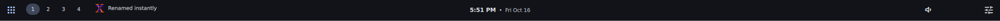
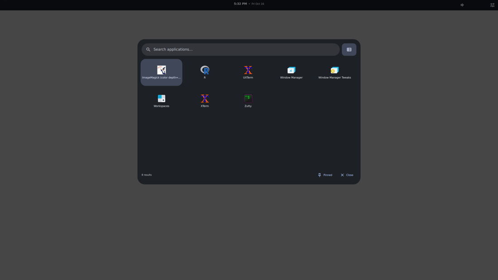
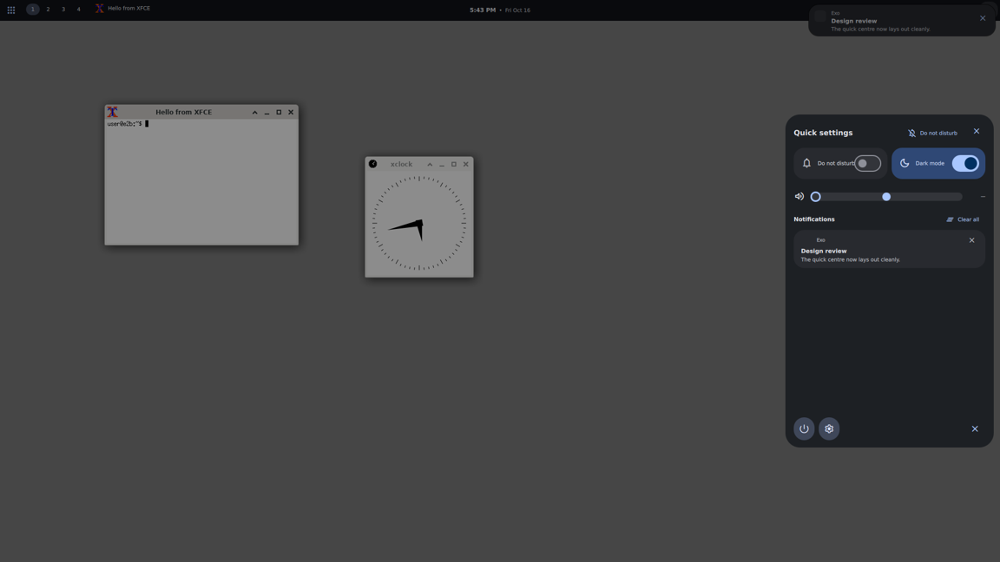
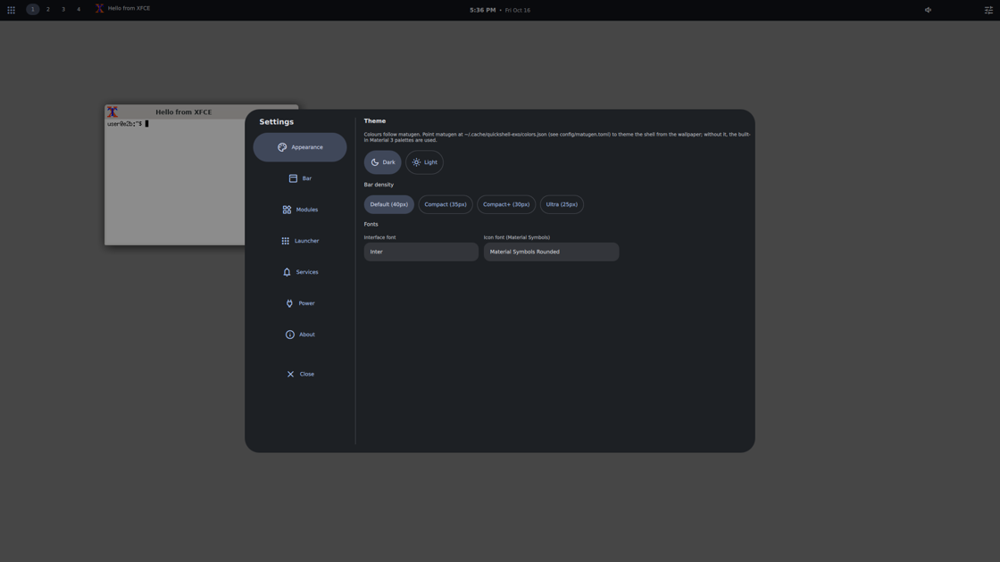
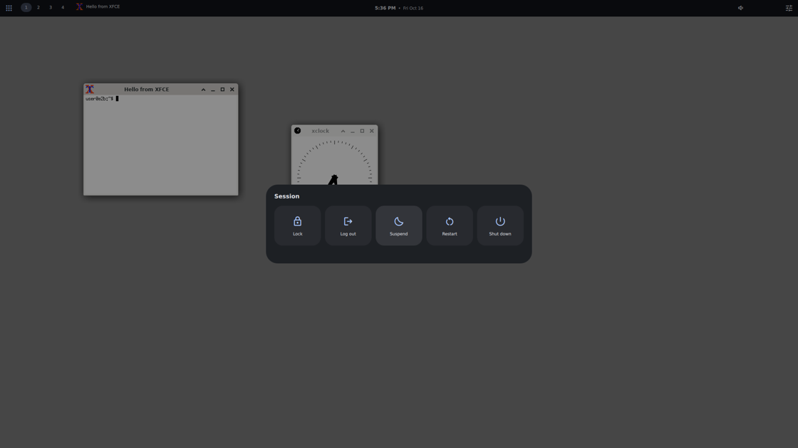

## NOTE

This is a port generated by an Agentic A.I. (used on [arena.ai](https://arena.ai)). The "workspace" can be viewed on `/Agent_AI/workspace-01a145b0-fd5a-76c3-bca2-216b16e0acef.zip`.  
I gave a quick test of both versions by running `qs -p ~/.config/quickshell/quickshell-exo/shell.qml`  and for what I could see, it worked for the most part.  
But if you try to actually run it, you are on your own. I am not responsible for what happens.  
I uploaded it for this repo just for future references.  

# Exo for XFCE

**A Material 3 inspired desktop shell for XFCE (xfwm4) on X11, built with [Quickshell](https://quickshell.org).**

This is a port of [debuggyo/Exo](https://github.com/debuggyo/Exo) — originally an
[Ignis](https://github.com/ignis-sh/ignis)-based shell for the Wayland compositors
niri and Hyprland — to a completely different stack: Quickshell, X11 and xfwm4.

<p align="center">
  
</p>

---

## What it looks like

| | |
|---|---|
|  |  |
| Application launcher with search, pinning and context menus | Quick centre: toggles, sliders and notifications |
|  |  |
| In-shell settings (appearance, bar, modules, launcher, services, power) | Power menu with confirm-on-destructive actions |

---

## Features

- **Material 3 bar** — left / centre / right zones, movable and toggleable
  modules, four density presets, and Exo's bar styles (floating, separated,
  round, centred, vertical).
- **Application launcher** — grid or list, search by name/generic name/keywords,
  keyboard navigation, pinning, per-application desktop actions.
- **Quick centre** — Wi-Fi / Bluetooth / do-not-disturb / dark-mode toggles,
  volume and brightness sliders, notification list with per-item dismiss and
  "clear all".
- **Notifications** — a real `org.freedesktop.Notifications` server with
  popups, actions, inline replies, images and markup.
- **Media widget** — MPRIS player with album art, transport controls and scroll
  to change the volume.
- **System tray** — SNI/AppIndicator items including their native context menus.
- **Workspaces & taskbar** — xfwm4 desktops and windows straight from EWMH.
- **Focused-window module** — title and icon, with click-to-minimise,
  middle-click-to-close and right-click-to-maximise.
- **OSD** — volume and brightness overlay, horizontal or vertical, anchored
  anywhere.
- **Settings window** — everything above is configurable from inside the shell.
- **Dynamic theming** — matugen brings your wallpaper colours to the shell,
  with Material 3 fallback palettes when it is not configured.
- **IPC** — every action is scriptable (`exo toggle-launcher &c.`), so XFCE
  keyboard shortcuts can drive the shell.

---

## Requirements

| Dependency | Why |
|---|---|
| **Quickshell ≥ 0.3** built with X11 support and Qt 6.6+ | the shell toolkit |
| **wmctrl** | workspaces, window list, window activation (EWMH) |
| **xprop** (x11-utils) | focused window and fullscreen detection |
| **Material Symbols font** | every icon in the UI |
| *optional* **xdotool** | gives the launcher keyboard focus under xfwm4 |
| *optional* **libxcb** + a C compiler | builds `bin/x11-events` for event-driven updates |
| *optional* **matugen** | wallpaper-derived colour schemes |
| *optional* **brightnessctl** | screen brightness when `/sys/class/backlight` is not writable |
| *optional* **notify-send** (libnotify) | test notifications from scripts |
| *optional* **kitty** | terminal applications from the launcher (configurable) |

Quickshell must have X11 support compiled in (it is on by default). Verify with:

```bash
qs --version            # 0.3.x or newer
echo $XDG_SESSION_TYPE  # should be "x11"
```

Quickshell is packaged on Arch (`quickshell`), Fedora
(`dnf copr enable errornointernet/quickshell`), NixOS (`nixpkgs#quickshell`) and
on FreeBSD; on Debian/Ubuntu it currently has to be built from source.

---

## Installation

```bash
git clone https://github.com/<you>/exo-xfce.git ~/.local/share/exo-xfce
cd ~/.local/share/exo-xfce
./scripts/setup.sh
```

`setup.sh` checks dependencies, builds the optional X11 event helper, installs
the Material Symbols font if needed, applies the xfwm4 settings the shell wants,
links the checkout to `~/.config/quickshell/exo` and adds an XFCE autostart
entry. Every step can be skipped:

```bash
./scripts/setup.sh --no-font --no-integration --no-autostart
```

Then start it:

```bash
qs -c exo              # foreground, Ctrl+C to stop
qs -c exo & disown     # background
```

The autostart entry starts it with your XFCE session. Since Quickshell hot-reloads
QML, you never need to restart the shell while tweaking it: save a file and the
bar reloads in place.

### Manual installation

```bash
git clone https://github.com/<you>/exo-xfce.git
mkdir -p ~/.config/quickshell
ln -s "$PWD/exo-xfce" ~/.config/quickshell/exo
qs -c exo
```

To use the optional helper and font by hand:

```bash
cc -O2 -o bin/x11-events scripts/x11-events.c -lxcb    # needs libxcb1-dev / libxcb-devel
./scripts/install-font.sh                               # Material Symbols into ~/.local/share/fonts
./scripts/xfce-integration.sh --shortcuts               # xfwm4 settings + key bindings
```

---

## Usage

### Keyboard shortcuts

`scripts/xfce-integration.sh --shortcuts` installs these (Settings → Keyboard →
Application Shortcuts to edit them):

| Shortcut | Action |
|---|---|
| `Super+Space` | toggle the launcher |
| `Super+S` | toggle the quick centre |
| `Super+Escape` | toggle the power menu |
| `Super+,` | open settings |
| `Super+/` | toggle do-not-disturb |
| `Super+KP_Add` / `Super+KP_Subtract` | volume up / down |
| `Super+M` | mute |

Anything else can be bound to the same CLI:

```bash
exo toggle-launcher
exo brightness-up
exo workspace 2
echo '#!/bin/sh' > ~/bin/screenshot-focus.sh   # or bind whole scripts
```

Add the checkout's `bin/` to your `PATH` (or use the absolute path
`~/.config/quickshell/exo/bin/exo`).

### Inside the launcher

| Key | Action |
|---|---|
| Type | filter applications |
| `↑` `↓` `←` `→` | move the selection |
| `Enter` | launch |
| `Tab` | switch grid/list layout |
| `Esc` | close |

Right-click an application to pin it or use its desktop actions (e.g. "New
private window"). "Pinned" in the footer shows the pinned entries.

### Bar interactions

| Module | Left click | Middle click | Right click | Scroll |
|---|---|---|---|---|
| Launcher | open launcher | — | — | — |
| Workspaces | switch desktop | — | — | — |
| Window info | minimise | close | toggle maximise | minimise |
| Taskbar chip | activate | close | toggle maximise | — |
| Media | play/pause | — | — | volume |
| Status icons | quick centre | — | toggle Wi-Fi/Bluetooth | volume |
| Battery | quick centre | — | — | — |
| Clock | quick centre | — | settings | — |
| Tray icon | activate app | secondary activate | app menu | app scroll action |

### Command line (IPC)

```bash
exo version                        # shell version
exo state                          # X11/workspace/window diagnostics
exo toggle-launcher
exo open-settings
exo volume-up 0.1                  # optional step, 0-1
exo brightness-down
exo workspace 3                    # switch to the 4th xfwm4 workspace
exo focus-window firefox           # raise a window by class or title
exo notify "Title" "Body"
exo toggle-dnd
exo reload                         # reload the QML in place
```

`exo --help` lists everything.

---

## Configuration

Everything lives in `config.json` next to `shell.qml` (created on first run,
written by the settings window). `config/config.example.json` documents every
key with comments.

```json
{
    "barPosition": "top",
    "barDensity": 0,
    "barModulesLeft": ["launcher", "workspaces", "windowInfo"],
    "barModulesCenter": ["clock"],
    "barModulesRight": ["media", "statusIcons", "tray", "battery", "quickSettings"]
}
```

Available modules: `launcher`, `workspaces`, `windowInfo`, `tasks`, `media`,
`tray`, `statusIcons`, `battery`, `clock`, `quickSettings`.
Available zones: `barModulesLeft`, `barModulesCenter`, `barModulesRight`.

After editing the file by hand, press **Reload shell** in
Settings → About (or run `exo reload`). The settings window writes changes
itself, so they apply instantly.

### Theming with matugen

```bash
mkdir -p ~/.config/matugen/templates ~/.cache/quickshell-exo
cp config/matugen/exo-colors.json ~/.config/matugen/templates/
# merge config/matugen.toml into ~/.config/matugen/config.toml
matugen image ~/Pictures/wallpaper.jpg
```

The shell reads `~/.cache/quickshell-exo/colors.json` (dark) and, if present,
`~/.cache/quickshell-exo/colors-light.json` (light). Both files are watched, so
the whole UI recolours the moment matugen rewrites them. Without these files the
built-in Material 3 palettes are used, and Settings → Appearance switches
between the dark and light variants.

---

## How the X11 port works

Exo (Wayland) leans on compositor protocols that do not exist on X11. Here is
what replaces them:

| Wayland / Ignis | X11 replacement |
|---|---|
| `zwlr_layer_shell` panels, per-monitor bar windows | Quickshell `PanelWindow`, mapped to EWMH dock windows; `exclusiveZone` becomes `_NET_WM_STRUT(_PARTIAL)`, so xfwm4 keeps maximised windows below the bar (`wmctrl -d` shows the reserved work area) |
| Floating/popup shell windows (Wayland only in Quickshell) | one full-screen, click-through `PanelWindow` overlay hosting the launcher, quick centre, power menu, settings and the inline-reply prompt |
| Niri/Hyprland workspaces over their IPC sockets | `X11.qml` reads `_NET_CURRENT_DESKTOP` / `_NET_NUMBER_OF_DESKTOPS` / `_NET_DESKTOP_NAMES` and switches with `wmctrl -s N` |
| Hyprland/niri focused-window and window-list APIs | `_NET_ACTIVE_WINDOW`, `_NET_CLIENT_LIST`, `_NET_WM_NAME`, `WM_CLASS` via the event helper or `wmctrl` |
| Compositor auto-hide / fullscreen signals | `_NET_WM_STATE_FULLSCREEN` on the active window hides the bar when `barAutoHideFullscreen` is on |
| `swww` wallpaper daemon + matugen | matugen only; XFCE (xfdesktop) keeps drawing the wallpaper |
| Compositor key bindings | XFCE keyboard shortcuts calling `exo …` over IPC |
| `hyprlock` theming, niri-specific gestures | out of scope — XFCE keeps `xflock4` |

Two details worth knowing if you modify the code:

- **Property names starting with `on`** (e.g. `Theme.colors.onSurface`) are kept
  inside a nested object, because QML reserves `on<Capital>` for signal handlers.
- **Popup windows are not implemented on X11** in Quickshell, hence the single
  overlay surface. Native tray/dbus menus still work, because those are real
  `QMenu`s that xfwm4 manages itself.

### The X11 event helper

`scripts/x11-events.c` is a small XCB client that watches `_NET_*` property
changes on the root window and every client, and prints a line only when
something actually changed. `scripts/setup.sh` builds it into `bin/x11-events`.
Without it the shell falls back to `scripts/x11-poll.sh`, which polls
`wmctrl`/`xprop` every `x11PollInterval` ms and emits exactly the same protocol:

```
DESKTOP <active>|<count>|<name>|...
ACTIVE <window-id>
WINDOWS <id>|<desktop>|<pid>|<wmclass>|<title>;<tab>...
FULLSCREEN <0|1>
```

(the `<pid>` field is `_NET_WM_PID`, which the shell compares against its own
process id to keep its surfaces — bar, overlay, OSD, toasts — out of the task
list, and to keep showing the focused application while an overlay holds the
keyboard.)

Either way the shell behaves identically — the helper just reacts instantly.

---

## Troubleshooting

**The launcher opens but I cannot type into it.**
xfwm4 is refusing to focus the freshly mapped overlay. Run
`./scripts/xfce-integration.sh` (it lowers focus stealing prevention and enables
"focus new windows"), or set it by hand in
*Settings → Window Manager Tweaks → Focus*.

**Icons show as empty boxes.**
The Material Symbols font is missing: `./scripts/install-font.sh`, then
`exo reload`.

**The bar overlaps maximised windows.**
The window manager did not apply the strut. Check `wmctrl -d`: the `WA:` field
should show `0,40` for a 40 px top bar. If it shows `0,0`, something is forcing
the bar's `exclusiveZone` to 0 — that happens while `barAutoHideFullscreen` is
active and a fullscreen window is focused.

**No workspaces / no window titles in the bar.**
`wmctrl` is missing or X11.qml cannot see the display. `exo state` prints what
the shell currently knows, including whether the helper is active.

**Notifications do not appear.**
Another daemon may already own `org.freedesktop.Notifications`. Quickshell
registers when the shell starts, so stop `xfce4-notifyd`
(`xfce4-notifyd-config` → disable, or `pkill xfce4-notifyd`) and restart Exo.

**Brightness slider is missing.**
No writable `/sys/class/backlight` device and no `brightnessctl`. Install it, or
set `brightnessDevice` in `config.json`.

**Nothing renders, or the bar is empty.**
Check `qs log` for QML errors, and make sure you are in an X11 session
(`echo $XDG_SESSION_TYPE`).

---

## Repository layout

```
shell.qml                  entry point: bars, overlay, OSD, notification stack
services/                  Theme, Config, X11 (EWMH), Apps, Pinned, Osd, Notifs
components/                M3 primitives: button, icon, slider, switch, chip, menu
bar/                       Bar.qml + Zone.qml + one file per module
overlays/                  OverlaySurface + Launcher, QuickCenter, PowerMenu,
                           Settings, ReplyPrompt
notifications/             ToastWindow (panel) + Toast (card)
config/                    config.example.json, matugen template + config
scripts/                   setup.sh, xfce-integration.sh, install-font.sh,
                           x11-events.c, x11-poll.sh, focus-overlay.sh
bin/                       exo (CLI/IPC wrapper), x11-events (built)
docs/                      screenshots
```

---

## Credits & licence

- Original **Exo** for niri/Hyprland: [debuggyo/Exo](https://github.com/debuggyo/Exo) (GPL-3.0)
- Shell toolkit: [Quickshell](https://quickshell.org)
- Design language: [Material 3](https://m3.material.io/)
- Icons: [Material Symbols](https://fonts.google.com/icons)

Licensed under the **GPL-3.0**, the same licence as the original project.
See [LICENSE](LICENSE).
